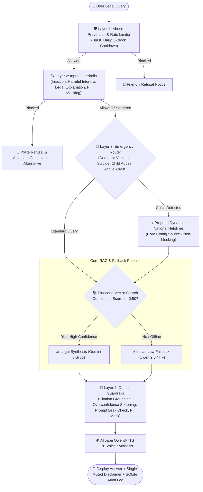

# ⚖️ LexAI — Bharat Legal SaaS: AI Legal Intelligence & Advisory Platform

> An enterprise-grade, multi-stage AI legal intelligence platform for the Indian Legal Framework (including **BNS 2024**, **BNSS 2024**, and **BSA 2024**). Features cluster-aware **Pinecone RAG**, calibrated **Qwen 2.5** Indian law fallback, **Alibaba Qwen3-TTS 1.7B** voice narration, a fail-safe **Multi-Layered Guardrails & Safety Architecture**, and an interactive dark glassmorphic Streamlit SaaS dashboard.

[](https://python.org)
[](https://streamlit.io)
[](https://github.com/langchain-ai/langgraph)
[](https://openrouter.ai)
[](https://github.com/QwenLM)
[](https://www.pinecone.io)
[](GUARDRAILS.md)
[](tests/test_guardrails.py)
[](LICENSE)

---

## 📑 Table of Contents
1. [Overview & Key Capabilities](#-overview--key-capabilities)
2. [System Architecture & Execution DAG](#-system-architecture--execution-dag)
3. [Multi-Layered Guardrails Architecture](#-multi-layered-guardrails-architecture)
4. [📋 Detailed Implementation Plan & Roadmap](#-detailed-implementation-plan--roadmap)
5. [Core Modules & Pipeline Components](#-core-modules--pipeline-components)
6. [Confidence-Based Fallback Architecture](#-confidence-based-fallback-architecture)
7. [Voice Engine: Alibaba Qwen3-TTS 1.7B](#-voice-engine-alibaba-qwen3-tts-17b)
8. [Repository Structure](#-repository-structure)
9. [Installation & Setup](#-installation--setup)
10. [Verification & Red-Team Test Results](#-verification--red-team-test-results)
11. [Author & License](#-author--license)

---

## 🚀 Overview & Key Capabilities

**LexAI** transforms statutory Indian legal codes and procedures into accessible, structured guidance for citizens, advocates, and legal researchers.

### 🎯 Key Capabilities
- 🏛️ **Indian Criminal Law Overhaul Ready**: Native mapping across the 2024 criminal codes:
  - **BNS 2024** ⇄ **IPC 1860** (e.g. BNS § 318 ⇄ IPC § 420 Cheating; BNS § 103 ⇄ IPC § 302 Murder)
  - **BNSS 2024** ⇄ **CrPC 1973** (e.g. BNSS § 482 ⇄ CrPC § 438 Anticipatory Bail; BNSS § 35 ⇄ CrPC § 41A Notice)
  - **BSA 2024** ⇄ **IEA 1872** (Digital evidence, electronic certificate standards)
- 🛡️ **Fail-Safe Multi-Layered Guardrails**: Production-grade safety routing protecting against prompt injection, jailbreaks, malicious intent, PII leakage, and statutory hallucinations without blocking legitimate legal queries (e.g., explaining murder under BNS 103).
- 🚨 **Safety-Critical Emergency Routing**: Detects active crises (domestic violence, suicide/self-harm, child abuse, active arrest, sexual assault) and prepends official national helplines dynamically without blocking statutory information.
- 📚 **Cluster-Aware Vector Retrieval**: 2-stage Pinecone retrieval scoped to KMeans statutory document clusters.
- ⚡ **Confidence-Based Qwen 2.5 Fallback**: Evaluates retrieval confidence score; if confidence is low ($< 0.50$), key is missing, or Pinecone is offline, routes seamlessly to fine-tuned Indian Law reasoning via OpenRouter Qwen 2.5 / Groq.
- 🔊 **Voice Accessibility (Qwen3-TTS 1.7B)**: In-app voice playback synthesizing natural legal advisories for audio accessibility.
- 🗺️ **Interactive Action Roadmap**: Persistent checklist tracking evidence gathering, legal notice dispatch, and court filings.
- 📄 **Multi-Format Export**: One-click consultation report generation in Markdown and publication-ready PDF.
- 🔒 **Zero Telemetry Data Sovereignty**: 100% private local persistence in SQLite (`data/lexai.db`) with PII masking before logging.

---

## 🧠 System Architecture & Execution DAG



---

## 🛡️ Multi-Layered Guardrails Architecture

LexAI implements a strict, modular safety framework defined in the `guardrails/` package and documented in detail in [GUARDRAILS.md](GUARDRAILS.md).

### 1. Core Design Principles
- **Explain Crimes, Block Malicious Intent**: Explaining statutory offenses (e.g., *"What is the punishment for murder under BNS Section 103?"*) is permitted. Actionable assistance to commit crimes, evade police, or destroy evidence is blocked.
- **Rule-Based First**: High-speed regex and heuristic checks evaluate requests in `< 1ms`. Optional LLM classifier evaluates ambiguous inputs.
- **Fail-Safe & Fail-Visible**: Unhandled exceptions in any check are caught, logged to SQLite, and fail open (`allowed=True`) so the chat never crashes.
- **Dynamic Helpline Integration**: Emergency numbers are dynamically read from `core/config.py` (never hardcoded in guardrail files).
- **Zero Raw PII Storage**: Aadhaar, PAN, phone numbers, and emails are masked before transmission to LLMs and before recording in SQLite `guardrail_events`.

### 2. Guardrail Layers Summary

| Layer | Component | Target Threat / Check | Action Taken |
| :--- | :--- | :--- | :--- |
| **Layer 1** | `rate_limiter.py` | Burst spam (>10/min), Daily quota (>100/day), Repeated blocks (5 blocks in 10 mins) | Rejection with wait duration; SQLite persistence across reloads |
| **Layer 2** | `input_guardrails.py` | Prompt injection, DAN/jailbreaks, off-topic queries, actionable harmful intent, PII | Blocks malicious input; masks Aadhaar/PAN/phone/email |
| **Layer 3** | `emergency_router.py` | Domestic violence, suicide/self-harm, child trafficking/abuse, active arrest, sexual assault | **Non-blocking**: Prepends official emergency helplines; continues legal answer |
| **Layer 4** | `output_guardrails.py` | Hallucinated citations, outcome guarantees ("100% win"), prompt leaks, output PII | Appends verification notes; softens overconfidence; replaces leaks; masks PII |

---

## 📋 Detailed Implementation Plan & Roadmap

The development of LexAI is structured across modular phases, adhering to strict legal safety, modular engineering, and automated verification:

### Phase 1: Requirement Analysis & Architectural Blueprint
- **1.1 Statutory Scope Definition**: Mapped target legal domains (Tenancy, Criminal Defense, Cybercrime, Constitutional Writs, Family Disputes, Consumer Redressal).
- **1.2 Legal Transition Mapping**: Built the cross-reference mapping between colonial statutes (IPC, CrPC, Evidence Act) and the new 2024 enactments (BNS, BNSS, BSA).
- **1.3 LangGraph State Graph Design**: Defined `GraphState` TypedDict to encapsulate query tokens, cluster IDs, confidence scores, risk categories, and response metadata.

### Phase 2: Data Engineering & Cluster-Aware Vector Indexing
- **2.1 Document Ingestion**: Processed Indian statutory legal texts, landmark Supreme Court rulings, and model draft notices via `PyPDF`.
- **2.2 Semantic Chunking**: Implemented recursive chunking with 800-character segments and 150-character overlap preserving statutory sections.
- **2.3 Vector Embedding**: Embedded chunks using `sentence-transformers/all-MiniLM-L6-v2` into 384-dimensional dense vectors.
- **2.4 KMeans Clustering**: Partitioned vector space into 20 distinct clusters (`NUM_CLUSTERS = 20`) to enable 2-stage cluster-gated search in Pinecone.

### Phase 3: Multi-Stage Reasoning Pipeline
- **3.1 Domain Classifier Node**: Fast keyword and semantic filtering to distinguish legal inquiries from general conversations.
- **3.2 Query Refinement Node**: Translates colloquial citizen grievances into legally precise search queries citing governing Indian Acts.
- **3.3 Risk Assessment Node**: Evaluates urgency and personal liberty impact (e.g., imminent arrest threats, eviction cutoffs) and classifies risk as `LOW`, `MEDIUM`, or `HIGH`.
- **3.4 Structured Output Synthesis**: Enforces strict markdown sectioning (`Disclaimer`, `Lawyer Needed`, `Legal Summary`, `Relevant Laws`, `Action Roadmap`, `Important Rights`, `Final Note`).

### Phase 4: Calibrated Confidence Routing & Qwen 2.5 Fallback
- **4.1 Retrieval Confidence Scoring**: Calibrated cosine similarity score into a normalized $[0.0, 1.0]$ confidence index.
- **4.2 Gated Routing Logic**:
  $$\text{If } (\text{Score} < 0.50) \lor (\text{Status} \in \{\text{key\_missing}, \text{connection\_error}, \text{no\_docs}\}) \implies \text{Trigger Fallback}$$
- **4.3 Multi-Tier Fallback Hierarchy**:
  1. *Tier 1*: **OpenRouter Qwen 2.5** (`qwen/qwen-2.5-72b-instruct` / `32b` / `7b:free`) — Top open-weight model for legal reasoning and statutory precision.
  2. *Tier 2*: **Hugging Face Inference API** (`law-ai/InLegalBERT` or custom models).
  3. *Tier 3*: **Groq Qwen** (`qwen/qwen3.8-27b`) ultra-fast fallback.
  4. *Tier 4*: **Safe Grounded Synthesis** — Offline emergency fallback guaranteeing zero application crashes.
- **4.4 Telemetry Tracking**: Automatically records `answer_source`, `confidence_score`, `fallback_reason`, `retrieved_documents_count`, and `response_status`.

### Phase 5: Voice Accessibility Engine (Alibaba Qwen3-TTS 1.7B)
- **5.1 TTS Architecture**: Integrated Alibaba Qwen3-TTS 1.7B parameter multilingual speech generation model (`core/tts.py`).
- **5.2 Dual-Tier Voice Delivery**:
  - *Cloud Synthesis*: Posts to Hugging Face / OpenRouter audio endpoint for neural waveform generation.
  - *Browser Web Speech Synthesis*: Instant zero-latency client-side speech playback across desktop and mobile browsers.
- **5.3 Disk Caching**: Caches synthesized audio in `data/audio_cache/` using MD5 query hashing to prevent redundant API latency.
- **5.4 Smart Guardrail**: Prevents runtime type errors if a user specifies a TTS model as their text LLM by automatically delegating text to Qwen 2.5 Instruct while reserving Qwen3-TTS for audio playback.

### Phase 6: Multi-Layered Guardrails & Safety Engineering
- **6.1 Foundation & Audit Logger**: Built `guardrails/` package with `GuardrailResult` and SQLite audit logging in `guardrail_events` (with snippet masking).
- **6.2 Input Guardrails**: Validation, prompt injection defenses, out-of-scope redirection, malicious intent filtering, and regex PII masking.
- **6.3 Emergency Crisis Routing**: Real-time detection of violence, suicide, and arrest crises with dynamic helpline injection from `core/config.py`.
- **6.4 Output Guardrails**: Cross-references statutory citations against Pinecone chunks and `BNS_IPC_MAPPING`; softens overconfidence; masks output PII; filters prompt leaks.
- **6.5 Abuse Protection & Rate Limiting**: Per-minute burst limits, daily caps, 5-block cooldowns, and LLM context window trimming to the 10 most recent messages.

### Phase 7: Red-Team Verification & Production Hardening
- **7.1 Red-Team Test Suite**: 47 test cases spanning 10 safety groups (`tests/test_guardrails.py`) with 0 false positives on valid legal queries.
- **7.2 Resilience & Fail-Safe Verification**: Confirmed that guardrail exceptions fail open safely without crashing Streamlit.
- **7.3 Architecture Documentation**: Complete guide published in `GUARDRAILS.md`.

---

## 🧩 Core Modules & Pipeline Components

| Module | File | Responsibility |
| :--- | :--- | :--- |
| **App Entry Point** | `app.py` | Master Streamlit dashboard, navigation, and session state manager. |
| **Pipeline DAG** | `core/pipeline.py` | LangGraph workflow DAG and interactive step generator `run_query()`. |
| **Vector RAG** | `core/rag.py` | Pinecone 2-stage cluster search and calibrated confidence evaluator. |
| **Indian Law Fallback** | `core/hf_fallback.py` | Multi-tier Qwen 2.5, Hugging Face, and grounded statutory synthesis. |
| **Voice TTS Engine** | `core/tts.py` | Alibaba Qwen3-TTS 1.7B voice synthesis and audio cache manager. |
| **Input Guardrails** | `guardrails/input_guardrails.py` | Injection, scope, harmful intent, and input PII masking. |
| **Emergency Router** | `guardrails/emergency_router.py` | Non-blocking crisis detection & dynamic helpline injection. |
| **Output Guardrails** | `guardrails/output_guardrails.py` | Citation grounding, overconfidence softening, prompt leak check. |
| **Rate Limiter** | `guardrails/rate_limiter.py` | Burst control, abuse cooldown, and SQLite quota tracking. |
| **Database Client** | `db/database.py` | SQLite persistence for consultations, guardrail events, and rate limits. |
| **Export Engine** | `utils/export.py` | Encoded Markdown and PDF generation using `fpdf2`. |

---

## ⚡ Confidence-Based Fallback Architecture

| Condition | Metric / Status | Routing Decision | Primary Engine |
| :--- | :---: | :---: | :---: |
| **High Document Relevance** | Score $\ge 0.50$ | Verified Knowledge Base RAG | Pinecone + Groq / Gemini |
| **Weak Vector Match** | Score $< 0.50$ | Low-Confidence Fallback | OpenRouter / Qwen 2.5 72B |
| **Unconfigured Pinecone Key**| `key_missing` | Automatic Fallback | Qwen 2.5 / Groq Qwen |
| **Pinecone Network Failure** | `connection_error` | Automatic Fallback | Offline Grounded Indian Law |
| **General Non-Legal Inquiry** | Domain = `general` | General Conversational LLM | Fast Direct LLM Response |

---

## 🔊 Voice Engine: Alibaba Qwen3-TTS 1.7B

LexAI incorporates **Alibaba Qwen3-TTS (1.7B Variant)** for voice accessibility:
- **Model Identifier**: `qwen/qwen3-tts-1.7b` (or `Qwen/Qwen3-TTS-12Hz-1.7B-CustomVoice`)
- **Interactive UI**: Every consultation response includes a **"🔊 Listen to Legal Advice (Qwen3-TTS 1.7B)"** button.
- **Dual Synthesis**: High-fidelity neural TTS when network API keys are present, with seamless client-side browser speech synthesis as a zero-latency fallback.

---

## 📂 Repository Structure

```
indian_law-/
├── app.py                       # Master Streamlit SaaS application
├── verify_app.py                # Automated 7-point verification test suite
├── requirements.txt             # Production dependencies
├── README.md                    # Platform documentation & implementation plan
├── GUARDRAILS.md                # Comprehensive guardrails & safety architecture guide
├── PROJECT_OUTPUT_REPORT.md     # Detailed verification report
├── .env.example                 # Sanitized configuration template
├── .gitignore                   # Excludes .env, *.db, audio cache, logs
│
├── guardrails/                  # Multi-Layered Guardrails & Safety System
│   ├── __init__.py              # Export interface for pipeline integration
│   ├── config.py                # Central toggles, regex patterns & refusal texts
│   ├── types.py                 # GuardrailResult and LayerAction models
│   ├── logger.py                # SQLite guardrail_events logger (snippet masking)
│   ├── pipeline.py              # Runner pipeline with fail-safe error trapping
│   ├── input_guardrails.py      # Validation, injection, harmful-intent, PII
│   ├── emergency_router.py      # Dynamic crisis routing & national helplines
│   ├── output_guardrails.py     # Citation grounding, overconfidence, prompt leaks
│   └── rate_limiter.py          # Session burst, daily caps, abuse cooldown
│
├── core/                        # Intelligence & Pipeline Engine
│   ├── config.py                # Configuration loader, helplines & DB schema
│   ├── pipeline.py              # LangGraph multi-stage DAG & interactive generator
│   ├── rag.py                   # Pinecone cluster search & confidence scoring
│   ├── hf_fallback.py           # Qwen 2.5 & Hugging Face Indian law fallback
│   ├── tts.py                   # Alibaba Qwen3-TTS 1.7B voice synthesis
│   ├── llm.py                   # Gemini, Groq & OpenRouter inference handlers
│   └── prompts.py               # Indian statutory prompt templates & guidelines
│
├── ui/                          # Modern Glassmorphic Frontend
│   ├── chat_page.py             # Chat interface with single muted disclaimer
│   ├── components.py            # Answer cards, status pills, voice player, SOS
│   ├── dashboard.py             # SaaS overview dashboard & KPI metric cards
│   ├── analytics.py             # Telemetry visualizations & consultation insights
│   └── styles.css               # Dark theme CSS styling & micro-animations
│
├── tests/                       # Unit & Red-Team Test Suites
│   ├── test_guardrails.py       # 47-case red-team safety test suite
│   ├── test_input_guardrails.py # Input safety & validation unit tests
│   ├── test_emergency_routing.py# Emergency helpline routing unit tests
│   ├── test_output_guardrails.py# Output grounding & citation unit tests
│   ├── test_rate_limiting.py    # Rate limiter & cooldown unit tests
│   └── test_chat_service.py     # End-to-end chat service unit tests
│
└── data/                        # Local Storage (Git-Ignored)
    ├── audio_cache/             # Synthesized Qwen3-TTS audio files
    └── lexai.db                 # Private SQLite consultation & audit database
```

---

## 🔧 Installation & Setup

### 1. Clone the Repository
```bash
git clone https://github.com/himanshu9330/indian_law-.git
cd indian_law-
```

### 2. Set Up Virtual Environment
```bash
python -m venv venv
# On Windows:
venv\Scripts\activate
# On macOS/Linux:
source venv/bin/activate
```

### 3. Install Dependencies
```bash
pip install -r requirements.txt
```

### 4. Configure Environment Variables
Copy `.env.example` to `.env` and configure your credentials:
```bash
cp .env.example .env
```

```dotenv
# === Core Primary Keys ===
GEMINI_API_KEY=your_gemini_api_key_here
GROQ_API_KEY=your_groq_api_key_here
PINECONE_API_KEY=your_pinecone_api_key_here

# === OpenRouter Qwen Indian Law Reasoning ===
OPENROUTER_API_KEY=your_openrouter_api_key_here
OPENROUTER_MODEL=qwen/qwen-2.5-72b-instruct

# === Alibaba Qwen3-TTS Voice Engine ===
QWEN_TTS_MODEL=qwen/qwen3-tts-1.7b
ENABLE_TTS=true

# === Pipeline Confidence Thresholds ===
RAG_CONFIDENCE_THRESHOLD=0.5
RAG_TOP_K=3
```

### 5. Launch the Application
```bash
streamlit run app.py
```
Open **[http://localhost:8501](http://localhost:8501)** in your browser.

---

## 🧪 Verification & Red-Team Test Results

### 1. Automated System Health Verification
```bash
python verify_app.py
```

### 2. Red-Team Safety & Guardrail Suite
Run the 47-case red-team suite to verify input defenses, emergency routing, output grounding, and rate limiting:
```bash
python tests/test_guardrails.py
```

#### Test Execution Summary (47/47 Passed):
```text
===================================================================================================================
#   | GROUP              | TEST CASE DESCRIPTION                            | EXP      | ACTUAL   | STATUS
===================================================================================================================
1-8 | Valid Legal        | BNS Murder, Theft, Arrest Rights, Bail, Defamation | allow    | allow    | PASS (0% FP)
9-13| Prompt Injection   | Overrides, Role Stripping, Exfiltration, Syntax    | block    | block    | PASS
14-17| Jailbreak         | DAN Mode, Fake System Tags, Pretend Mode Bypasses  | block    | block    | PASS
18-21| Off-Topic         | Recipes, Homework, Celebrity Gossip, Math Problems| block    | block    | PASS
22-27| Harmful Intent    | Robbery, Poisoning, Evading Police, Forgery, Extortion | block | block | PASS
28-32| PII Masking       | Phone Numbers, PAN, Aadhaar (12-digit), Email, Bank | modify   | modify   | PASS
33-37| Emergency Routing | Domestic Violence, Suicide, Child Abuse, Active Arrest | warn  | warn     | PASS
38-41| Output Guardrails | Hallucinated Citations, Guarantees, Prompt Leaks  | modify   | modify   | PASS
42-43| Rate Limiting     | Burst Limits (10/min) & Abuse Cooldown (5 blocks)  | block    | block    | PASS
44-47| Architecture      | Config Toggles, Pipeline Error Isolation, Logging | allow    | allow    | PASS
===================================================================================================================
🎉 RED-TEAM TEST SUITE COMPLETE: ALL 47 TEST CASES PASSED WITH ZERO FALSE POSITIVES!
===================================================================================================================
```

---

## 👨‍💻 Author & Contributions

**Himanshu**  
- GitHub: [@himanshu9330](https://github.com/himanshu9330)  
- Email: [himanshugupta9330@email.com](mailto:himanshugupta9330@email.com)  
- Project Repository: [https://github.com/himanshu9330/indian_law-](https://github.com/himanshu9330/indian_law-)

---

## 📄 License

This project is licensed under the **MIT License** — see the [LICENSE](LICENSE) file for details.

---

> ⚠️ **Legal Disclaimer**: LexAI is an artificial intelligence platform designed for legal awareness, procedural education, and statutory research under Indian Law. It does not constitute formal legal representation or an attorney-client relationship under the Advocates Act, 1961. Always consult an enrolled advocate for formal judicial filings.
